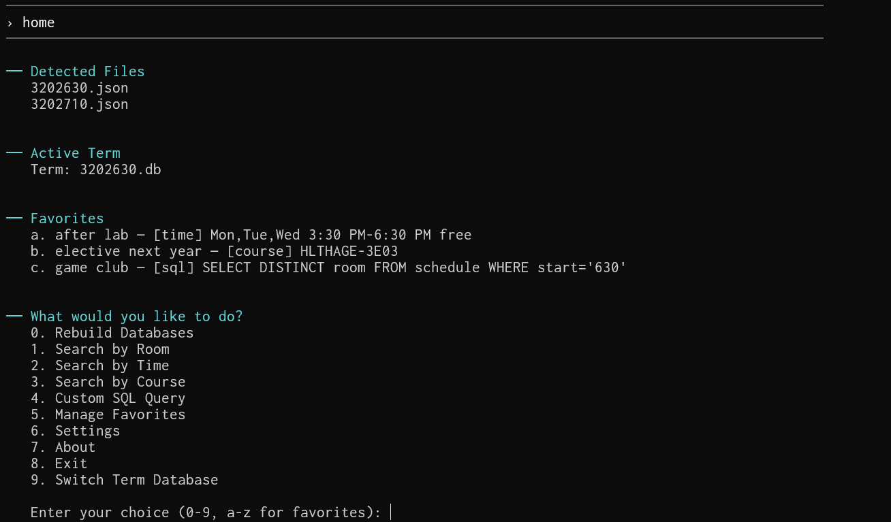

# OpenHalls 

OpenHalls is a project that provides a way to automatically scrape the MyTimetable API for course time data, sort it into JSON files, and provide a fast, clean, and easy-to-use CLI in Go to view the data. Includes CSV exports, favorites in-app, SQLite database building for fast and exportable schedules, convenient interface, and four different query types (including custom SQL query engine!).

This tool is very helpful if you want to sit in on a course's lectures, find out what times a room is occupied, learn more about a course you want to take, plan sections, find a calm area for a club meeting, get analytics on room/time use, and more!

</img>

# Usage

## Agent Install

I had GPT-6 slop up an installation guide in `./agent_install.md`, so you can point your favorite AI agent at that to install this if you want.

I did not actually try it, your results may vary. I still highly recommend reading through the manual install instructions below!!!

## Scraping data (Python)

Get the source code. You can do this through `git clone https://github.com/71cj34/openhalls` or by downloading the source code .zip in the releases section. Make the source code folder your CWD.

Requires Python 3.10+.

Run this: 

```bash
pip install -r requirements.txt
```
(if you get an error that pyfiglet is not compatible, then ignore it. It's not necessary for this project.)

Then run these commands:

```bash
# 1. Get valid semesters (--auto finds current terms or you can specify a semester with the pattern below)
# Getting each semester does take a while so if you are only concerned with one sem and want to speed things up, use 1a
python api.py --auto
# 1a.
python api.py --sem 3202630 # pattern: 3 + year + semester number + 0 where semester number: winter=1, spring/summer=2, fall=3

# 2. Class times + schedules (!! needs your browser cookie, see below)
python parse.py --semester 3202630 --cookie "..."
# 2a. The --no-fetch option assumes you already downloaded the data but the next step failed. This lets you retry from there
python parse.py --semester 3202630 --no-fetch
# 2b. Test n courses using --limit, specify a cookie file using --cookie-file, specify a course file with --course-file, force a reprocess with --force
python parse.py --semester 3202630 --cookie-file cookie.txt --course-file sample_data.json --limit 5 --force
```

These commands will take a hot second to run, especially `parse.py` (there are ~2000 courses to fetch per semester). If you're really impatient, you can use the `--delay` parameter (default 0.25) to lower the delay between fetches, at the risk of catching a rate limit from the API.
 
### Getting a cookie

Getting class data only works if you are logged in to MyTimetable. Since this script isn't a browser, you need to supply your browser cookie (basically your browser's authentication key to prove that you're you.)

1. Log in at https://mytimetable.mcmaster.ca in your browser.
2. Open DevTools (F12) > Network tab, search for any course and select it to add it to your timetable.
3. Click the request with `class-data` in its `File` > Request Headers > right click, Copy Value.
4. Use one of: `--cookie "..."`, `--cookie-file cookie.txt`,
   `MYTIMETABLE_COOKIE="..."` env var, or a `.env` file with `MYTIMETABLE_COOKIE=...`.

I don't know how long it takes, but the cookie will probably expire. If the script stops working, try readding your cookie.

## CLI

This repo contains a command-line interface to view the data using SQLite for super fast browsing. To use it, download a .exe from the releases tab on Github, or compile it yourself if you have Go 1.26+ installed. On Windows run `build.bat` / `buildonly.bat` in `src\hallview`, on Linux/macOS run `src/hallview/build.sh` / `src/hallview/buildonly.sh`. Make sure to `go get hallview` in the gomod's directory first! 

Once you have the binary (`hallview.exe` on Windows, `hallview` on Linux/macOS), place it somewhere in the folder structure between the root folder (the folder containing the .xml, .json, python files, etc) and the Go source files. Run it in an existing terminal with `.\hallview.exe` on Windows or `./hallview` on Linux/macOS (or equivalent based on your CWD). For Linux, remember to `chmod +x`. 

Alternatively, use the `run_cli.bat`/`run_cli.sh` file in the same folder as this README.md file to automagically locate the exe and run it. The program will give you instructions, troubleshooting, etc from there.

The `crosscompile.ps1` file at repo root is what I use to compile Linux binaries from Windows. You can also use it if you need to. If you are on an ARM server for some reason, use `$env:GOARCH = "arm64"` instead. If you are on anything else, try `go tool dist list` to view all valid `GOOS/GOARCH` combos.

TL;DR: Download latest release from [here](https://github.com/71cj34/openhalls/releases/latest), put it in this folder, then run the `run_cli.bat` file.

Settings:
- **Hide Lab Rooms**: Rooms that are used for labs are also included, but since they're usually locked or are really uncomfortable to be in for anything that isn't the lab, this option allows you to automatically hide any rooms that have lab sections in them.
- **Autofill Search Limit**: How many rooms to show you in the autofill results when you mistype or type a partial string.
  - Does not apply to custom SQL search.
- **Search Result Limit**: How many rows to show you in the search results by time and such.
  - Does not apply to custom SQL search.

### Why is all this so complicated?

Because this stuff is all only accesible to McMaster students, and it's kind of a security risk for me to just give out all the information about every course. Also, it's easier to maintain once I inevitably leave this school and can no longer test/update the script since I don't have credentials anymore.

Also I need a project for my portfolio in a backend language. And CLIs are baller. That too.


# Contributing

Hi! Thanks for being interested in contributing to this repo.

Submit a PR with a summary of your changes and we'll review it and get back to you ASAP.

If you have a feature request or find a bug, then open a GitHub issue and we'll take a look.
